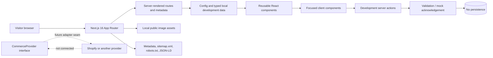
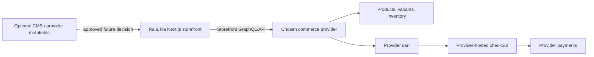
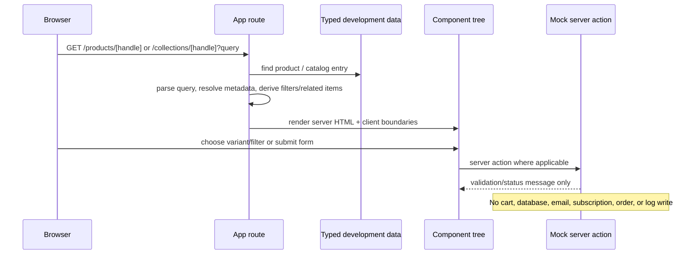

# Ra & Ra — Project Context and Migration Handoff

> **Shopify test update — 2026-11-06:** The repository now contains an optional
> server-only Shopify Storefront API adapter, Shopify-backed product/collection
> reads, inventory-aware variants, a persistent HTTP-only-cookie cart, live bag
> controls, Storefront search, and Shopify-hosted checkout redirection. When the
> Shopify environment variables are absent, the site falls back to a local INR
> 699 test catalogue using the 300-unit quantity plan from the supplied RFQ
> workbook. Customer accounts remain disabled and global prelaunch noindex rules
> remain active. Treat older statements below that say Shopify/cart is entirely
> unimplemented as historical status preceding this update.

> **Audit snapshot:** 2026-11-01, working tree at commit `40eae4d28c5205f07cffa5715a5f60e6353739ee` on `main` before this document was added.  
> **Purpose:** give a replacement Codex instance enough verified context to continue safely. This is a development storefront, **not** a launch-ready ecommerce system.

## Evidence and reading guide

This document distinguishes evidence deliberately:

- **Verified in code** means the current tracked source/configuration was inspected.
- **Verified in Git** means it is present in local Git metadata/history.
- **Historical requirement** means it was found in the two accessible Ra & Ra Codex task histories; it may describe an intended future state rather than current code.
- **Unknown** means no accessible code, configuration, asset, or task history confirmed it. Do not fill these gaps by assumption.

The audit found 189 tracked files below `src/`, 118 component files, 15 page route files (five development showcases), 18 public assets, no tracked tests, and no tracked CI/deployment workflow. `pnpm lint`, `pnpm typecheck`, and `pnpm build` all passed during this audit.

## 1. Project Identity and Overview

**Project:** Ra & Ra (`ra-ra`, private package version `0.1.0`).

**Purpose — verified in code and historical requirements:** a premium, story-led lifestyle apparel storefront. The first collection concept is **Dogs & Their Humans**: minimal dog-themed T-shirts intended to represent a pet-owner relationship rather than novelty merchandise. The architecture is explicitly designed for future themed collections such as travel, coffee, nature, fitness, gaming, music, books, seasonal themes, and limited drops.

**Primary intended market:** Germany and the European Union; the current development market is Germany, English locale, and EUR.

**Target users:** dog owners, pet/animal lovers, people buying meaningful gifts for dog owners, and buyers seeking restrained apparel rather than loud novelty pet merchandise. Future collections broaden the audience, so the master brand must not become structurally dog-only.

**Current stage:** frontend and content-model prototype. It has a polished component system, static/mock product data, editorial routes, responsive collections/product browsing, and a brand loader. It has no live products, checkout, payment, orders, customer accounts, database, authentication, email delivery, CMS, analytics, or production legal/policy content.

**Long-term objective:** combine emotional storytelling with practical product discovery and provider-hosted ecommerce. The product, imagery, copy, motion, collections, and purchase interface should read as one narrative while keeping commerce information immediately accessible.

## 2. Project Vision and Requirements

### Source-of-truth hierarchy — historical requirement

1. The supplied business/idea PDF was declared authoritative for positioning, audience, legal scope, required pages, homepage scope, mobile-first and performance direction.
2. Supplied product artwork, mockups, dog-owner photography, and hero concepts establish product and emotional direction; they do **not** prove specifications, inventory, or approved claims.
3. Supplied third-party website screenshots are structural references only: hierarchy, navigation, section rhythm, product discovery, and footer organization. Their brand, palette, copy, categories, and exact design must not be copied.

### Product and experience principles — historical requirement, reflected in current implementation

- Lead with meaningful connections, shared identity, memories, and everyday moments—not merely printed T-shirts.
- Be modern, minimal, premium, emotional, creative, and timeless: clean grids, generous whitespace, controlled alignment, high-quality imagery, and restrained motion.
- Avoid gradients as a dominant device, glassmorphism, neon, trend-heavy 3D, excessive decoration, cluttered cards, and animation without purpose.
- Use warm off-white/ivory, beige/oatmeal, charcoal, muted brown/taupe, soft borders, and natural imagery through centralized semantic tokens rather than component-local colors.
- Keep the hero concise: one heading, short description, at most two CTAs, strong contrast, stable height, and responsive focal points.
- Keep the first collection dog-centric while maintaining collection-first, data-driven architecture.
- Never claim sustainability, organic materials, ethical manufacture, verified reviews, real availability, production pricing, or policies until confirmed.

### Required eventual route scope — historical requirement

Home, shop, collections overview/detail, product detail, About, Journal/article, Contact, FAQ, Size Guide, Shipping, Returns, Privacy, Terms, Impressum, Withdrawal, Cart, Search, and Account were requested. Wishlist, gift guide, limited editions, and order tracking were proposed future routes. Only the routes documented in section 7 currently exist.

## 3. Current Development Status

| Area | Status | Current reality |
|---|---|---|
| Design system and global shell | Implemented | Tokens, fonts, layout primitives, header, footer, focus/reduced-motion baseline, and loading boundary exist. |
| Homepage storytelling and product discovery | Implemented with mock data | Hero, discovery, featured collection, new arrivals, brand promise, collection cards, best sellers, and editorial banner render. |
| Collection browsing | Implemented with mock data | Overview, pets detail, empty travel fixture, URL sorting/filtering/pagination, and structured-data foundation. |
| Product detail | Implemented with mock data | Gallery, variants, size/quantity, feedback, related products, mobile purchase bar, and structured-data foundation. No cart changes. |
| Editorial pages | Implemented with development content | About, Journal/articles, Contact, FAQ, and Size Guide share reusable editorial components. |
| Newsletter, reviews, community | Components/showcases implemented; production disabled | Feature flags are false. No real provider/customer content is shown. |
| Branded loading animation | Implemented | Global `loading.tsx` renders reusable animated owner/dog loader. |
| Commerce, cart, checkout, payment, inventory, orders | Not implemented | Mock server actions only validate/acknowledge; they persist nothing. |
| CMS, database, search, accounts, wishlist, consent, analytics | Not implemented | No corresponding provider/client/server code or dependencies. |
| Production launch | Blocked | Missing provider integration, content/legal decisions, routes, operations, and deployment configuration. |

## 4. Complete Technology Stack

### Installed direct dependencies — verified from `pnpm-lock.yaml`

| Technology | Locked version | Purpose and locations |
|---|---:|---|
| Next.js | 16.2.10 | App Router, metadata routes, server components/actions, image optimization, static generation/build. `src/app`, `next.config.ts`. |
| React | 19.2.4 | Components, state, transitions, `useActionState`, and client interaction. |
| React DOM | 19.2.4 | React browser/server runtime. |
| TypeScript | 5.9.3 | Strict static typing throughout `src`; no emitted JS from `tsc`. |
| Tailwind CSS | 4.3.3 | Utility styling imported by `src/app/globals.css`; semantic values are CSS variables. |
| `@tailwindcss/postcss` | 4.3.3 | Tailwind PostCSS plugin, configured in `postcss.config.mjs`. |
| Lucide React | 1.25.0 | Navigation, dialogs, gallery, and action icons. |
| ESLint | 9.39.5 | `pnpm lint`; flat config in `eslint.config.mjs`. |
| `eslint-config-next` | 16.2.10 | Next Core Web Vitals and TypeScript lint presets. |
| `@types/node` | 20.19.43 | Node typings. |
| `@types/react` / `@types/react-dom` | 19.2.17 / 19.2.3 | React typings. |

### Platform and implementation choices — verified in code

- **pnpm:** lockfile v9 and workspace allowlist (`sharp`, `unrs-resolver`) in `pnpm-workspace.yaml`. No `packageManager` field pins a pnpm binary version.
- **Fonts:** `next/font/google` loads Cormorant Garamond (display) and Manrope (body) in `src/app/layout.tsx`; the resulting variables feed the design tokens. There is no runtime third-party font stylesheet.
- **Images:** local assets only, rendered with `next/image`; `next.config.ts` restricts image output quality options to 65 and 75. No remote image host is configured.
- **Styles:** one global Tailwind/CSS token system plus a CSS module for the loader. No CSS-in-JS, animation library, component library, state manager, form library, Zod, React Hook Form, or Framer Motion is installed.
- **Validation:** local handcrafted email/contact validators. No schema library is installed.
- **Browser APIs:** `IntersectionObserver` powers the mobile sticky purchase bar; `matchMedia` respects reduced motion; native `FormData`, URL query handling, `Intl.NumberFormat`, and `BigInt` are used.

### Not installed / only planned

Shopify, Medusa, WooCommerce, CMS SDKs, databases/ORMs, authentication providers, payment SDKs, email/newsletter SDKs, analytics, consent manager, review service, test framework, E2E framework, Docker, and CI/CD are **not** present. A historical decision sequence later favored Shopify, but that is not yet represented by a dependency, environment variable use, or API call.

## 5. System Architecture

### Current architecture — verified in code



The app intentionally has a **configuration/data → route → reusable component** shape. Most pages are server components. Files ending `.client.tsx` are the client boundaries for dialogs, navigation, variant selection, galleries, filter drawer/sort control, and form state. Files beginning with `"use server"` are development-only action adapters; they are not a backend service or persistence layer.

### Intended ecommerce architecture — historical direction, not implemented



Historical conversations say the user chose/was proceeding with Shopify, a Germany-based business setup, and a provider-hosted checkout recommendation. Treat this as the likely integration direction, but reconfirm provider, hosted-checkout decision, launch language, markets, tax display, and editorial ownership before writing the adapter. No card data should pass through this app if provider-hosted checkout is used.

### Current request/data flow



### Deployment architecture

There is no provider-specific deployment configuration, container, infrastructure-as-code, custom server, environment-host configuration, or CI pipeline. This is a standard `next build` / `next start` application shape. The build succeeded locally using Turbopack. Hosting target is **unknown**.

## 6. Directory and Source Code Documentation

### Application routes and runtime

| Location | Responsibility and important behavior |
|---|---|
| `src/app/layout.tsx` | Root HTML shell: English language, Cormorant/Manrope variables, skip link, header, main landmark, footer, global metadata/viewport. Root metadata defaults to `noindex,nofollow`. |
| `src/app/page.tsx` | Home composition. Reads `homepage.ts` plus `developmentCollection`; derives new arrivals/best sellers locally. Reviews/newsletter/community only render when feature flags become true. |
| `src/app/loading.tsx` | Global App Router loading boundary using full-screen `JourneyLoader`. |
| `src/app/globals.css` | Canonical semantic tokens, typography, reset, focus ring, responsive art direction, dialog transitions, rails, and global reduced-motion treatment. Do not scatter replacement colors/spacing in components without updating this system. |
| `src/app/collections/page.tsx` | Collections overview route using visible catalog summaries; deliberately noindexed. |
| `src/app/collections/[collectionHandle]/page.tsx` | Reusable collection route. Builds facets from products, parses canonical query state, redirects overlarge page numbers, conditionally passes mock quick add for active collections, and emits CollectionPage JSON-LD. |
| `src/app/products/[productHandle]/page.tsx` | Dynamic product route with static params, SEO, product JSON-LD, related-product selection, and mock add-to-cart adapter. |
| `src/app/about`, `contact`, `faq`, `size-guide`, `journal`, `journal/[slug]` | Editorial routes assembled from typed local content and reusable editorial components. |
| `src/app/robots.ts` | Disallows all crawlers (`/`) while still exposing the sitemap URL. This is a deliberate prelaunch posture. |
| `src/app/sitemap.ts` | Generates home, collection, editorial, and development-editorial URLs from local data. Review before launch because the global robots/noindex posture and development data make this unsuitable as final launch SEO. |
| `src/app/development/*` | Component verification pages for product cards, reviews, newsletter, community, and loader. Community/newsletter/reviews return 404 under production; product cards and journey loader currently do not. |

### Data, configuration, contracts, and actions

| Location | Responsibility |
|---|---|
| `src/config/site.ts` | Site name/url resolver, Germany/EUR development market, feature flags, header/nav configuration, placeholder contact email. Invalid `NEXT_PUBLIC_SITE_URL` fails production configuration; absent value falls back to localhost in development. |
| `src/config/homepage.ts` | All homepage content, supplied image references, product IDs, focal points, section presentation, and disabled provider placeholders. It is the first place to change approved homepage copy/order/data—not the components. |
| `src/config/footer.ts` | Footer statement/nav groups/market display/cookie trigger. Several configured destinations are not routes yet. |
| `src/config/*themes.ts` | Controlled class maps for product, collection-card, feature, and storefront collection themes. `CollectionThemeKey` is deliberately a narrow union. |
| `src/config/product-page.ts` | Development warning and generic shipping/returns/related-product copy. |
| `src/data/development/mock-commerce.ts` | Six intentionally non-production product fixtures, variant generator, pets collection, lookups. Covers alternate image, changed variant price/image, unavailable combination, one-option product, long title, sold out, and missing image. |
| `src/data/development/mock-collections.ts` | Catalog containing active pets and empty `travel-development` reuse fixture, plus collection lookups/visible summaries. |
| `src/data/development/editorial-content.ts` | About, three development Journal articles, FAQ, Contact/Size Guide heroes, Size Chart and safe placeholder copy. |
| `src/data/development/mock-reviews.ts`, `mock-community.ts` | Clearly-labelled fixtures for isolated development showcases. They must not be presented as real customer/social content. |
| `src/lib/commerce/types.ts` | Provider-neutral `Money`, product, variant, collection, SEO, content status, and market contracts. Money is a decimal string intentionally—not a JavaScript number. |
| `src/lib/commerce/provider.ts` | Read-only product/collection provider seam. Cart, checkout, accounts, and inventory synchronization are intentionally deferred. |
| `src/lib/commerce/product-card.ts`, `variant-resolution.ts` | Sold-out/badge/color helpers and canonical color/colour-aware variant resolution/availability. Reuse these rather than rebuilding selection logic. |
| `src/lib/collections/*` | Facet construction, query parse/canonicalization, filtering, ordering, pagination, active-filter helpers. Server rendering is driven by URL state rather than a client-store. |
| `src/lib/utilities/*` | `cn`, absolute URL building, current-nav detection, and safe string-decimal money comparison/ranges/formatting. |
| `src/lib/validation/*` | Email/contact normalization, required fields, format, and character limits. |
| `src/features/*` | Four `"use server"` development adapters. Their successful messages explicitly state that no cart/email/subscription/message is written. |
| `src/types/*` | Page/component contracts for navigation, content, collections, product cards/details, footer, forms, reviews, and storytelling. Keep new integration data mapped into these contracts. |

### Component systems

| Component area | How it works |
|---|---|
| `components/layout` | `Container`, `Section`, `Stack`, `SkipLink`, footer pieces. They centralize page widths/spacing and semantic structure. |
| `components/ui` | Button style factory, visually hidden text, and a reusable client modal with focus trap, Escape/overlay close, scroll lock, and focus restoration. `ui/journey-loader` is inline SVG plus CSS animation, not a raster animation or library dependency. |
| `components/navigation` | Config-driven announcement/header. Desktop dropdown and mobile drawer are separate interactive components. Search/cart open honest unavailable dialogs; no account/wishlist UI is exposed. |
| `components/storytelling` | Hero, brand promise, editorial banner, review grid, and community grid. Hero model permits video in types but `HeroMedia` throws unless the active media type is `image`; video rendering is deliberately deferred. |
| `components/commerce/discovery` | Config-driven category cards; native horizontal mobile rail and responsive grid; supplied local imagery and focal points. |
| `components/commerce/featured-collection` | Story/presentation + campaign media + minimal preview product cards, split layouts driven by collection theme/configuration. |
| `components/commerce/collection-navigation` | Homepage “Shop by Collection”; active links only for approved active content, visual coming-soon state otherwise. |
| `components/commerce/product-card` and `product-showcase` | Reusable standard/compact/editorial cards, image fallback/alternate hover, limited badges, color and quick-add client boundaries, modal selection, loading skeleton, and configurable grids/rails. |
| `components/commerce/collections` | Reusable hero/introduction/results/filter/pagination/structured-data system. Desktop filters submit GET immediately; mobile drawer preserves draft form state until Apply; sort uses URL navigation transition. |
| `components/commerce/product-detail` | Server template plus focused client purchase experience: gallery, option availability, quantity, result feedback, sticky mobile action, factual info/story, related products, JSON-LD. |
| `components/editorial` | Editorial layout/hero, typed rich-text renderer, article/FAQ structured data, accordion-like FAQ item, journal card/grid, breadcrumbs, CTA, and size table. |
| `components/forms` | Contact/newsletter React form actions with accessible labels, error/status messages, pending state, and development-safe server action hooks. |

### Public assets

`public/` holds only local campaign/product/discovery images and the first-collection imagery: `hero/`, `featured-collection/`, `collections/`, `discovery/`, `editorial/`, and `development-products/`. Alt text and intrinsic dimensions live primarily in the typed config/data rather than being inferred at render time. The original brief/media/reference files from Phase 0 are **not** in this repository; their original external locations are no longer a reliable handoff source.

## 7. Frontend Implementation

### Existing pages

| Route | Status and behavior |
|---|---|
| `/` | Full composed prototype homepage. It has no page-level metadata export; root metadata applies. |
| `/collections` | Collection overview: active pets and coming-soon travel fixture. |
| `/collections/pets` | Active mock catalog with 6 fixture products, facets, sort, filters, page size 4, quick-add feedback, and noindex metadata. |
| `/collections/travel-development` | Reusable empty, coming-soon collection template; no products/inventory are fabricated. |
| `/products/[six development handles]` | Static development product detail pages, including sold-out and missing-image states. |
| `/about` | Development About story and CTA. The “Our Story” nav anchor points to `#our-story`, but the current About blocks do not visibly define that ID; verify/fix when working on navigation. |
| `/journal` and three `/journal/[slug]` routes | Development editorial index and typed article pages. |
| `/contact` | Active development validation UI. In production it returns an unavailable delivery message after valid input. |
| `/faq` | Expand/collapse FAQ content with only confirmed/development-safe answers. |
| `/size-guide` | Structure and Pending cells only; no approved measurements. |
| `/development/product-cards`, `/development/journey-loader` | Noindex development pages. Currently reachable in production because no production guard exists. |
| `/development/newsletter`, `/development/community`, `/development/reviews` | Noindex showcases that call `notFound()` when `NODE_ENV === "production"`. |

### Homepage order — verified in `src/app/page.tsx`

1. Campaign hero
2. Discovery categories
3. Featured pets collection
4. New arrivals (derived from `isNew` fixtures)
5. Brand promise
6. Shop by collection
7. Featured favourites/best sellers (derived from `isBestSeller` fixtures)
8. Emotional editorial banner
9. Optional reviews (currently disabled)
10. Optional newsletter (currently disabled)
11. Optional community grid (currently disabled)

The header announcement and footer are outside the page in the root layout. Homepage components are server-rendered except focused interactive children.

### Accessibility and responsive implementation

- Semantic landmarks, one page-level main, skip link, focus-visible outline, native controls, button minimum target token (44px), named regions, and screen-reader labels are used broadly.
- `ModalDialog` traps focus, restores it, handles Escape, locks body scrolling, and supports drawer/center placement. Both search and cart placeholders use it.
- Product dialogs, gallery controls, variant selectors, mobile nav, FAQ, filter controls, and forms have ARIA/state feedback; product/mobile actions use polite live regions.
- Mobile layouts use rails where intended (discovery/product cards), responsive CSS grids, safe-area padding, and an `IntersectionObserver` sticky purchase action that hides near the footer.
- Global reduced-motion CSS compresses animation/transition duration. The loader has its own static fallback for its walking/paw animation.
- The recent loader history recorded verification at 320–1440px without observed clipping/overflow in Chromium. Safari/Firefox manual QA is still not represented in the repository.

## 8. Backend Implementation

There is no traditional backend service, API server, database layer, or `src/app/api` route.

The only server-side mutation-like code is these Next Server Actions:

| Action | Validation/action | Persistence in current code |
|---|---|---|
| `developmentQuickAdd` | Requires product ID, variant ID, quantity exactly `1`. | None; does not even look up product/variant. |
| `developmentAddToCart` | Looks up fixture product/variant, enforces available variant and quantity >= 1. | None; does not update a cart. |
| `submitDevelopmentNewsletter` | Normalizes/validates email; adds 150ms development delay. | None; returns unavailable in production. |
| `submitDevelopmentContact` | Validates name/email/subject/message. | None; valid production requests receive unavailable response. |

The current browser-to-action boundary should be replaced behind the existing types/interfaces, not by placing provider credentials in client components or `NEXT_PUBLIC_*` variables.

## 9. Database Architecture

**None exists.** There are no database packages, schemas, migrations, models, queries, connection variables in use, or persistence operations. All commerce, editorial, reviews, community, form, and navigation data is static TypeScript configuration/data in the repository.

For a future provider integration, decide the system of record before adding a database. Shopify (if confirmed) can own products, variants, inventory, carts, checkout, orders, and customer identity; an optional CMS/provider metafields can own story/editorial fields. Do not create a parallel local product/order database without an approved responsibility boundary.

## 10. API Documentation

**No HTTP/REST/GraphQL endpoints are implemented by this repository.** `robots.txt` and `sitemap.xml` are Next metadata routes, not business APIs.

The prepared adapter boundary is:

```ts
interface CommerceProvider {
  getProducts(query?: ProductQuery): Promise<readonly Product[]>;
  getProductByHandle(handle: string): Promise<Product | null>;
  getCollections(): Promise<readonly Collection[]>;
  getCollectionByHandle(handle: string): Promise<Collection | null>;
}
```

It intentionally has no cart, checkout, account, inventory-sync, payment, or order methods. Extend it only after selecting the provider and hosted/custom checkout strategy. Current product query/filter behavior is in-process over fixture arrays; it is not an API contract.

## 11. AI/ML and Hardware Implementation

None. The project does not contain an AI/ML model, inference API, vector store, hardware integration, device protocol, or telemetry. Visual assets are checked-in raster files and an editable inline SVG loader; their original creation workflow is not fully recoverable from code.

## 12. Authentication and Security

### Current state — verified

- No customer/admin authentication or authorization exists.
- No payment card data, customer records, orders, carts, accounts, or tokens are stored.
- `.env.example` contains names/placeholders only; no actual credentials were found or recorded in this document.
- `.gitignore` excludes all `.env*` except `.env.example`, Node/Next build artifacts, logs, `.pem`, and Vercel output.
- Input validation trims/lowercases email, uses a basic email regex and 254-character limit; contact fields are required and capped at 100/254/140/3000 characters.
- Server actions use development fixtures and safe failure behavior in production rather than claiming to send/store data.
- A valid production `NEXT_PUBLIC_SITE_URL` is required by `siteConfig` or it throws; its public nature is appropriate for a site origin only.

### Security work required before enabling production features

1. Use server-only secret variables for provider/CMS/email keys; validate their presence at startup and rotate them outside source control.
2. Implement provider authentication and authorization with least-privilege Storefront/API tokens. Never expose admin/provider secrets to the browser.
3. Use provider-hosted checkout unless a custom PCI/security scope is explicitly approved.
4. Add server-side rate limiting, abuse protection/CAPTCHA where appropriate, audit logging, and provider error handling before enabling contact/newsletter/cart mutations.
5. Finalize consent, privacy, retention, DSAR, cookie, legal, and German/EU customer-policy processes with qualified legal/privacy review. Current placeholder copy is not legal documentation.
6. Reassess server-action origin/CSRF behavior and headers on the actual deployment host; no custom security-header policy is configured.

## 13. UI/UX Design Decisions

### Design system

The canonical system is in `globals.css`:

- warm background `#f7f3ec`, surface `#fffcf7`, muted surface `#ede6dc`, foreground `#28231f`, muted foreground `#6f655d`, border `#d7cec3`, warm accent `#8a5d3b`;
- Cormorant Garamond display typography and Manrope body typography;
- fluid page/section/container sizing, 44px interaction target, 6 layer z-index scheme, subtle radius/elevation, and 120/180/280ms motion tokens;
- mobile-first CSS with key breakpoints around 40rem, 48rem, 64rem, and 72rem.

Treat those values as **provisional semantic tokens**. Update approved brand values centrally and preserve component use of semantic token names.

### Layout and interaction choices

- Hero uses supplied dog-owner visual, left-aligned copy, a desktop gradient contrast overlay, responsive focal points, and no client JavaScript. Type supports video for the future but rendering deliberately refuses unapproved video.
- Discovery and product cards use native overflow rails on small screens rather than a heavy carousel library.
- Product card hover alternate imagery only activates on fine hover/pointer devices.
- Editorial pages are magazine-like: readable measure, rich-text blocks, image/callout/quote/two-column support, and visually distinct commerce vs. narrative roles.
- The emotional banner intentionally crops the image to exclude an unwanted baked-in slogan; do not casually reset its responsive scale/object position.
- Product page separates image, selection, facts/story, and related products. It never claims a completed purchase; the success copy says selection was confirmed and no cart changed.
- Reviews/community/newsletter use intentional blank/disabled states instead of manufactured social proof.

## 14. Development History

### Git timeline — verified

| Date | Commit | Implemented scope |
|---|---|---|
| 2026-07-21 | `ba0e20a` | Foundation: Next project, strict types, tokens, mock commerce contracts/data, shell/navigation primitives, initial homepage pieces. |
| 2026-07-21 | `1e11e8b` | New arrivals components/config/data. |
| 2026-07-21 | `500c1bb` | Shop-by-collection components/configuration. |
| 2026-07-22 | `e28e464` | Emotional editorial banner and image integration. |
| 2026-07-22 | `1c855c7` | Review components/fixtures/showcase. |
| 2026-07-22 | `453d585` | Newsletter/community/footer, validation and development pages. |
| 2026-07-22 | `4a01993` | Collection themes, pets/travel mock collection data, filter/query foundation. |
| 2026-07-22 | `776155d` | Collection route/templates/filters plus complete product-detail components and mock cart action. |
| 2026-07-22 | `a4821eb` | Editorial system and About/Journal/Contact/FAQ/Size Guide routes. |
| 2026-07-28 | `40eae4d` | JourneyLoader, global loading boundary, loader showcase and CSS animation. |

### Phase history — verified from accessible prior task history

| Phase | Result | Important preserved context |
|---|---|---|
| 0 | Planning only | Inspected an idea PDF, 12 artwork/mockup images, two hero images, a 10-second hero video, and four reference sites. No project was created until approval. Original source files are not in the repo now. |
| 1 | Foundation | App Router, strict TS, Tailwind tokens, accessibility baseline, provider-neutral commerce types. |
| 2 | Global header | Config-driven announcement/header/dropdowns/mobile drawer; search/cart are honest placeholders, account/wishlist disabled. |
| 3 | Hero | Only approved hero scope: supplied dog-owner image, responsive art direction, data model reserves video. |
| 4 | Discovery | Six configuration-driven categories, horizontal mobile scroll, no copied reference branding. |
| 5 | Featured collection | Reusable theme/config driven split storytelling section, not dog-hard-coded. |
| 6 | Product cards | Variants, quick add, badges, colors, modal/accessibility, mock-only cart boundary. |
| 7A–7I | Remaining homepage | New arrivals, brand promise, collections, best sellers, emotional banner, review/newsletter/community safeguards, footer, each built as a separate approved subphase. |
| 8 | Collections | Reusable filter/sort/pagination system; pets plus deliberately empty travel fixture verifies reuse. |
| 9 | Product detail | Variant resolver, gallery, sticky mobile action, story/facts/related products; no checkout/account/review integration. |
| 10 | Commerce integration | **Stopped intentionally** because provider, checkout, language, markets, tax display, and content ownership were unresolved at that time. No Phase 10 code was written. |
| 11 | Editorial pages | Reusable content system; development-safe articles/policies/forms and structured-data foundations. |
| Loader follow-up | Complete | Reference-informed inline SVG and CSS walking cycle; no new dependency, no numerical progress/progress bar/visible loader copy, reduced-motion fallback, global loading route. |

### Later operational discussion — historical, not code

- The user later stated “lets go with Shopify” and asked how to connect this frontend to product selling. Guidance recommended a Shopify Storefront API adapter, provider cart, and Shopify-hosted checkout.
- The company/bank account were later clarified as German, with Germany/EU as target market. Historic email/domain/mailbox discussions occurred, but no mail provider, Shopify credentials, DNS changes, legal policy content, or environment values are represented in this repository.
- This history supersedes an earlier exploratory response that discussed an India configuration before the German-company clarification. The code itself still only records a development Germany/EUR/English market.

## 15. Technical Decisions and Rationale

| Decision | Why it matters / do not casually change |
|---|---|
| Provider-neutral `Product`/`Collection` contracts | Prevents the UI from being locked to Shopify/Medusa/WooCommerce before the integration adapter is approved. Map provider payloads here, not throughout components. |
| Decimal-string money and `BigInt` comparison | Avoids floating-point state errors. Preserve string money externally and only format at presentation. |
| Local fixtures clearly marked `development` | Avoids accidental claims about real price, availability, reviews, or product specs. Replace only with approved source data. |
| Collections are the reusable center | Future themes must be data/config additions, not bespoke page implementations. The empty travel fixture is an intentional architecture test. |
| URL as collection state | Sort/filter/page must remain shareable, canonicalized, server-rendered, and browser-history friendly. Do not replace with opaque client state. |
| Focused client boundaries | Server components remain default for performance/SEO. Move only truly interactive code to the client. |
| `next/image` and explicit dimensions | Maintains responsive optimization and reduces layout shift. |
| No fabricated social proof or policy claims | Reviews/community/newsletter are disabled until factual/provider-backed. Maintain the honesty safeguards. |
| Provider-hosted checkout recommendation | Keeps payment-card handling outside this codebase and reduces operational/security scope. Still needs explicit implementation approval. |
| Central semantic tokens/theme maps | Future collection moods should enter through configuration and CSS variables/classes—not per-component palette forks. |
| Loader is SVG/CSS with reduced-motion handling | It must remain branded, lightweight, centered, accessible, and motion-sensitive; do not replace it with a generic spinner without direction. |

## 16. Bugs and Debugging History

There is no tracked issue tracker and no current runtime error was reproduced by lint, typecheck, or production build. Accessible task history records these relevant resolved/intentional events:

- Loader visual development initially required iteration on walking/body transforms, paw geometry/timing, and a browser check. The implementation was then adjusted and Chromium responsive checks passed from 320–1440px.
- A loader accessibility check found that the status needed an explicit stable accessible name; `aria-label={label}` was added to the root status. Keep this when refactoring the loader.
- Commerce integration was not “failed”; it was deliberately paused at Phase 10 rather than inventing checkout behavior while platform and operational choices were unresolved.
- Earlier original supplied assets and Phase 0 sources are not retained in the repository. This is a handoff limitation, not code failure.

## 17. Known Issues and Technical Debt

| Priority | Issue/status | Evidence and recommended next action |
|---|---|---|
| P0 launch blocker | No real commerce/cart/checkout/order/inventory integration | All current actions are non-persistent fixtures. Confirm Shopify design, then implement provider adapter, cart lifecycle, hosted checkout redirect, webhook/order strategy, and error states. |
| P0 launch blocker | Critical planned routes are missing | `/shop`, `/shipping`, `/returns`, `/privacy`, `/terms`, `/impressum`, `/withdrawal`, `/cart`, `/search`, and `/account` have no route directories. Existing nav/footer/product links therefore lead to 404. Build or temporarily remove/disable them before any public launch. |
| P0 launch blocker | Production crawler posture blocks indexing | Root metadata is `noindex,nofollow`; `robots.ts` disallows `/`; fixture SEO is noindex. Create an explicit launch SEO plan, real site URL, canonical strategy, and review sitemap before enabling indexing. |
| P0 launch blocker | Policies, contact, mailing, consent, and legal copy are placeholders | Contact address is `hello@example.invalid`; contact/newsletter never deliver; cookie control is disabled; size/material/shipping/returns/legal details are unapproved. Obtain verified operational/legal data and provider decisions. |
| P1 | Homepage feature flags leave reviews/newsletter/community absent | `reviewsEnabled`, `newsletterEnabled`, and `communityEnabled` are false. Keep them false until providers, consent, content approval, and privacy basis are ready. |
| P1 | Inconsistent production protection of development routes | Community/newsletter/reviews guard production; product cards and JourneyLoader showcases do not. Choose a uniform policy (guard/rewrite/remove) before deploy. |
| P1 | README is stale | It says the root route is a temporary development screen, but `src/app/page.tsx` now composes the full prototype homepage. Update it when project documentation becomes authoritative. |
| P1 | Header “Our Story” anchor is likely unresolved | Header uses `/about#our-story`; current typed About content does not define `id="our-story"`. Add a real target or change the link when navigation is next touched. |
| P2 | Footer/header product destinations overpromise availability | Shop/search/cart/account/placeholder dialogs are not real. Align navigation with completed routes or visible development status. |
| P2 | No automated tests or CI | There are no test/spec/E2E files and no `.github` workflows. Add unit tests for money/query/variant validation and E2E accessibility/navigation flows before provider integration. |
| P2 | No deployment/runtime policy | No Node version pin, hosting configuration, environment validation layer, preview deployment, error monitoring, analytics, security headers, caching policy, or CI. Select hosting before launch work. |
| P3 | `.env.example` has a malformed CMS comment | `# Future content integrationcvbnm,m.,n bm,n.mn` is harmless but confusing. Correct only during an approved configuration cleanup. |
| P3 | Fixture data is intentionally incomplete | No final products/SKUs/materials/care/measurements/pricing/availability/reviews/community content. Replace data after business approval; do not turn test strings into production claims. |

## 18. Pending Features

### Confirmed or explicitly required historical scope

- Shopify (or reconfirmed provider) storefront adapter and hosted checkout.
- Real product, variant, inventory, collection, merchandising, order, and payment flow.
- Shop, cart, search, account, shipping, returns, privacy, terms, impressum, and withdrawal routes.
- Approved Germany/EU policy, tax, shipping, returns, and customer-service data.
- Approved garment measurement, fit, care, material, manufacturing, and fulfillment information.
- Newsletter provider, consent wording/double opt-in decision, contact email delivery, and privacy operations.
- Verified review provider/first-party workflow and approved community-image process.
- CMS/metafields/content ownership decision for stories/articles/collection data.
- Actual language/localization strategy (English, German, or bilingual was unresolved in Phase 10).

### Suggestive only; not confirmed requirements

Wishlist, gift guide, limited-editions route, order tracking, rotating announcement messages, video hero, social embeds, analytics, account functionality, and collection-specific accent palettes beyond current themes. Evaluate after launch-critical work.

## 19. Future Roadmap

1. **Resolve operating decisions:** confirm Shopify, provider-hosted checkout, German/EU markets, default/secondary languages, tax display, shipping origin/fulfillment, policy owners, email/contact service, CMS/metafields, and real product source.
2. **Build commerce foundation:** implement server-only provider adapter and mapping layer; retain existing contracts; use real data to replace development fixtures; implement cart/checkout and provider error handling.
3. **Make routes truthful:** add the missing legal/service/shop/cart/search/account pages or remove all links; enable only providers and features that are operational.
4. **Approve and ingest content:** product facts, SKU/variant inventory, photos, final copy, collection dates, size/care guidance, policies, and translated content.
5. **Production hardening:** tests, CI, deployment config, secret management, rate limiting, monitoring, consent/analytics, headers, accessibility QA in multiple browsers, performance budgets, launch SEO.
6. **Post-launch enhancements:** reviews, community, newsletters, editor-managed storytelling, additional themed collections, account/wishlist/gift/order-tracking features as independently approved work.

## 20. Setup and Execution Instructions

### Prerequisites

- Node.js version is **not pinned** in source. Use a currently compatible Node version for Next 16 and the locked dependencies; record/pin it when deployment is selected.
- pnpm is required by the lockfile and package scripts.
- No external service is required for the existing prototype. Do not place real tokens in source or `NEXT_PUBLIC_*` variables.

### Commands verified in this audit

```bash
pnpm install --frozen-lockfile
pnpm dev
pnpm lint
pnpm typecheck
pnpm build
pnpm start
```

`pnpm install` is the normal future setup command; it was **not** run as part of this migration audit. The latter four script commands are declared in `package.json`; lint, typecheck, and build passed during this audit. Development server convention is Next’s default `http://localhost:3000`.

### Environment

Copy only when needed:

```bash
cp .env.example .env.local
```

Current variables and state:

| Variable | Current use |
|---|---|
| `NEXT_PUBLIC_SITE_URL` | Used by `siteConfig` to generate `metadataBase`, canonical URLs, sitemap, and robots sitemap link. A valid absolute production URL is required in production. |
| `COMMERCE_PROVIDER`, `COMMERCE_API_URL`, `COMMERCE_API_TOKEN` | Declared placeholders only; no code currently reads them. Keep a future API token server-only. |
| `CMS_API_URL`, `CMS_API_TOKEN` | Declared placeholders only. |
| `NEWSLETTER_PROVIDER`, `ANALYTICS_PROVIDER` | Declared placeholders only. |

Never commit `.env.local` or real credentials. The sample contains no usable secret.

### Debugging workflow

1. Run `pnpm lint` and `pnpm typecheck` first.
2. Run `pnpm build` to validate route generation and production compilation.
3. Use development showcases for isolated UI states: product cards, loader, newsletter, reviews, community.
4. Test responsive layouts and keyboard/focus behavior for the route being changed. Preserve reduced-motion behavior.
5. Before modifying commerce, test pure collection/money/variant helpers and add automated coverage—not just visual checks.

## 21. Deployment and Infrastructure

- **Configured deployment platform:** none found.
- **Remote host/CMS/commerce/database:** none configured.
- **Build output:** standard Next production build; the audit build generated 28 static pages and marked the collection detail route dynamic, journal/product detail as generated static paths, and metadata routes as static.
- **Images:** local `public` assets; no CDN/image-host config beyond Next defaults.
- **CI/CD:** none found.
- **Domain/mail/Shopify:** historical discussions exist but credentials, DNS state, provider configuration, and environment values are outside this repository and must be reconfirmed from the owner.

## 22. Git Status and Repository Information

| Item | Verified state at audit start |
|---|---|
| Repository | `https://github.com/basiljoy91/Ra---Ra.git` |
| Active branch | `main` |
| Upstream | `origin/main`; local `main` matched it before this documentation file was added. |
| HEAD | `40eae4d28c5205f07cffa5715a5f60e6353739ee` — `feat(loader): implement JourneyLoader component with customizable sizes and fullscreen option` |
| HEAD timestamp | 2026-07-28 21:39:21 +05:30 |
| Recent author on HEAD | `basiljoy91` (email intentionally omitted from this handoff) |
| Tags | none found |
| Working tree at audit start | clean |
| Uncommitted change made by this migration task | `PROJECT_CONTEXT.md` only; no source, dependency, branch, commit, or remote change was made. |

The local Git history contains the ten commits summarized in section 14; there are no additional local branches/tags revealing unmerged implementation.

## 23. Important Links and Resources

### Repository resources

- [GitHub repository](https://github.com/basiljoy91/Ra---Ra)
- `README.md` — early foundation document; useful but stale as noted above.
- `.env.example` — variable names only, not configured credentials.
- `src/config/homepage.ts` — current homepage source of truth.
- `src/lib/commerce/types.ts` and `src/lib/commerce/provider.ts` — mandatory integration seam.
- `src/data/development/` — all current non-production content/data fixtures.
- `public/` — currently tracked campaign/product assets.

### Historical resources no longer available in this repository

The Phase 0 task referenced an idea/business PDF, artwork/mockup folder, hero video/images, and visual reference screenshots from local user paths. Their contents influenced the build, but those originals are absent here. Ask the project owner to re-supply them if a future task requires source-quality assets, rights validation, video rendering, or exact reference comparison.

## 24. Critical Constraints

1. Do not turn fixture content into live commerce claims. Prices, availability, product facts, reviews, community images, policies, and founder/brand statements need approval.
2. Do not hard-code a dog-only storefront. Add future collections as typed data/configuration and approved theme mappings.
3. Do not couple UI components directly to Shopify (or another provider). Preserve/mature the provider-neutral mapping layer.
4. Do not implement a simulated checkout or claim that the mock action updated a cart. The historic instruction explicitly prohibited it before integration approval.
5. Do not expose provider/email/CMS credentials to the client, repository, logs, or `NEXT_PUBLIC_*` environment variables.
6. Do not add dependencies casually. The original brief requires an explanation of need, platform alternatives, bundle impact, and reuse before installing a package.
7. Do not invent legal, compliance, sustainability, payment, shipping, return, material, care, or customer-review content. Germany/EU requirements require qualified operational/legal confirmation.
8. Do not copy visual-reference brands, copy, colors, category systems, or exact layout pixel-for-pixel. Use them only as original structural inspiration.
9. Preserve accessibility contracts: semantic HTML, keyboard operation, visible focus, dialogs/focus return, image alt text, live feedback, touch targets, and reduced motion.
10. Preserve the global semantic token system and responsive image focal-point models. Do not solve an approved visual problem by scattering one-off inline styles.

## 25. Immediate Next Steps

Recommended next task sequence:

1. **Decision checkpoint:** get written confirmation of provider (likely Shopify), hosted checkout, markets, launch languages, VAT display, shipping/returns/legal ownership, email/newsletter provider, CMS/metafield ownership, and real product feed/source.
2. **Truthful navigation checkpoint:** decide whether to build or hide the missing routes. Do not expose 404 links on a public preview.
3. **Provider design task:** define a server-only Shopify adapter that maps Storefront responses to existing `Product`/`Collection` contracts; decide cart token/client strategy and error handling before coding.
4. **Content/legal intake:** replace only fields with approved material, product, size, care, photography, SEO, policy, and contact information.
5. **Production-readiness task:** add tests, CI, host/deployment configuration, `.env` validation, monitoring, rate limits/abuse controls, consent/analytics, security headers, cross-browser and assistive-technology QA.

## 26. Unknowns and Unverified Information

The following must be treated as unknown until the project owner supplies confirmation:

- Actual launch date, business/legal entity details, public domain/canonical URL, host, and deployment account.
- Whether Shopify was fully configured after the historical conversation, its store/API token state, plan, checkout/Markets/tax/shipping settings, and product synchronization plan.
- Final German/English/bilingual scope, market list, VAT presentation, IOSS/fulfillment/shipping arrangement, and all legal compliance content.
- Final product catalog, SKUs, price, currency display, stock, physical product specifications, supplier, manufacturer, materials, care, measurements/tolerances, imagery rights, and accessibility-approved image descriptions.
- Final brand/founder copy, social handles, review provider/process, community-content permissions, newsletter provider/consent/legal basis, contact mailbox, and cookie/analytics tools.
- Original input PDF, reference screenshots, original hero video, and source-resolution assets.
- Browser/device accessibility verification beyond the previously noted Chromium visual checks.

## 27. Instructions for the New Codex Instance

1. Start by reading this file, then `package.json`, `src/config/site.ts`, `src/config/homepage.ts`, the commerce contracts, and the target route/components. Treat current code as the implementation source of truth.
2. Before a production change, re-check every `development`/`Pending`/placeholder warning in the relevant data/config. Do not assume a polished UI represents live business capability.
3. If asked to implement commerce, first obtain the unresolved decisions in section 25. Design the provider mapper/server-only token flow before touching page components.
4. Make changes in the smallest approved phase. Preserve strict TypeScript, the server-first component model, provider-neutral types, URL-driven collection state, and existing accessibility contracts.
5. When working on navigation/footer/product purchase content, account for the missing routes and non-persistent mock actions. Avoid presenting unavailable behavior as active.
6. Validate proportionately: `pnpm lint`, `pnpm typecheck`, `pnpm build`, then focused responsive, keyboard, screen-reader/live-region, and reduced-motion checks for changed UI.
7. Update this document whenever a provider becomes live, a decision is confirmed, a security/deployment change lands, or a major fixture is replaced with approved content. Keep historical statements and verified code facts clearly separated.

